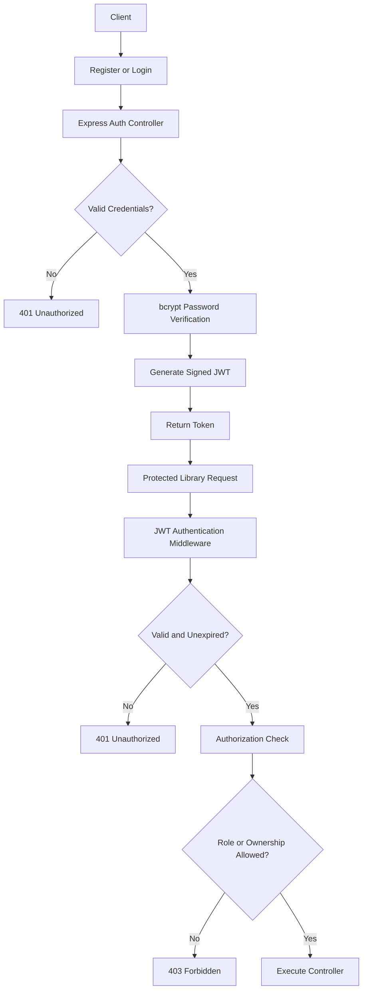

# Day 6 – Authentication & Authorization
## Library Lending API

A Node.js and Express REST API demonstrating JWT-based authentication and role-based authorization for a library lending system.

### 1. Features

- Member registration and login.
- Password hashing using bcryptjs.
- JWT authentication with configurable token expiry.
- Protected library routes.
- Role-based access control for librarians.
- Ownership validation for book holds.
- Overdue loan reminder preview restricted to librarians.
- Environment-based configuration to protect secrets.

### 2. Tech Stack

- Node.js
- Express.js
- bcryptjs
- jsonwebtoken
- dotenv

### 3. Project Structure

```text
Day-6/
├── src/
│   ├── controllers/
│   │   └── authController.js
│   ├── middleware/
│   │   └── authMiddleware.js
│   ├── routes/
│   │   ├── authRoutes.js
│   │   └── libraryRoutes.js
│   └── server.js
├── .env.example
├── .gitignore
├── package.json
└── README.md
```

### 4. Setup Instructions

**Prerequisites:** Node.js and npm.

1. Install dependencies:

```bash
npm install
```

2. Create a local `.env` file using `.env.example` as a template.

3. Configure the environment variables:

```env
PORT=5050
JWT_SECRET=your_long_random_secret
JWT_EXPIRES_IN=1h
LIBRARIAN_EMAIL=librarian@library.test
LIBRARIAN_PASSWORD=your_strong_password
```

4. Start the development server:

```bash
npm run dev
```

The API runs at `http://localhost:5050`.

Never commit `.env` or expose passwords, JWT secrets, or access tokens.

### 5. Authentication Flow



### 6. API Endpoints

All library endpoints require:

```http
Authorization: Bearer <JWT_TOKEN>
```

| Method | Endpoint | Access | Description |
|---|---|---|---|
| POST | `/api/auth/register` | Public | Register a member |
| POST | `/api/auth/login` | Public | Authenticate and receive JWT |
| GET | `/api/library/books` | Authenticated | View available books |
| POST | `/api/library/holds` | Authenticated | Place a book hold |
| GET | `/api/library/holds/my` | Authenticated | View your own holds |
| PATCH | `/api/library/holds/:id/cancel` | Owner only | Cancel your own hold |
| POST | `/api/library/reminders/overdue` | Librarian only | Preview overdue reminders |

#### Example: Member Registration

```http
POST /api/auth/register
Content-Type: application/json
```

```json
{
  "name": "Member A",
  "email": "membera@library.test",
  "password": "MemberA123!"
}
```

#### Example: Login

```http
POST /api/auth/login
Content-Type: application/json
```

```json
{
  "email": "membera@library.test",
  "password": "MemberA123!"
}
```

A successful login returns a signed JWT.

#### Example: Place a Hold

```http
POST /api/library/holds
Authorization: Bearer <JWT_TOKEN>
Content-Type: application/json
```

```json
{
  "bookId": "book-1"
}
```

### 7. Security Implementation

**Password hashing**

- Passwords are hashed using bcryptjs with 10 salt rounds.
- Plain-text passwords are never returned in API responses.
- Login uses bcrypt comparison rather than comparing stored plain-text passwords.

**JWT authentication**

- Tokens are signed using a secret stored in `.env`.
- The token contains the user's role and subject identifier.
- Token expiry is configurable through `JWT_EXPIRES_IN`.
- The default expiry is one hour.
- `jwt.verify()` validates the signature and expiry before protected routes execute.

**Role-based authorization**

- Every library route requires authentication.
- Only users with the `librarian` role can access overdue reminder previews.
- Regular members receive `403 Forbidden` when attempting librarian-only operations.

**Ownership validation**

- Each hold records the ID of the member who created it.
- Members can view only their own holds.
- A member cannot cancel another member's hold.
- The server checks ownership using the authenticated user's ID rather than trusting client-supplied ownership information.

### 8. Threat Considerations

| Threat | Mitigation |
|---|---|
| Password theft | bcrypt password hashing |
| Forged JWT | Signature verification |
| Expired token reuse | JWT expiration validation |
| Unauthorized access | Authentication middleware |
| Privilege escalation | Server-side role checks |
| Accessing another member's hold | Ownership validation |
| Secret exposure | `.env` excluded through `.gitignore` |

Additional production recommendations:

- Use HTTPS for all API communication.
- Add login rate limiting and request validation.
- Use a persistent database with unique email constraints.
- Keep JWT secrets out of source control and rotate them when necessary.
- Consider refresh-token rotation and secure token storage.
- Add audit logging for sensitive library operations.

### 9. Verification Evidence

The following checks were executed against the running API using curl:

| Test | Expected | Actual |
|---|---|---|
| Register Member A | 201 Created | PASS |
| Register Member B | 201 Created | PASS |
| Login as both members and librarian | JWT returned | PASS |
| Access books without token | 401 Unauthorized | PASS |
| Access books with Member A token | 200 OK | PASS |
| Create a hold as Member A | 201 Created | PASS |
| Cancel Member A's hold as Member B | 403 Forbidden | PASS |
| Cancel Member A's hold as Member A | 200 OK | PASS |
| Access overdue reminders as member | 403 Forbidden | PASS |
| Access overdue reminders as librarian | 200 OK | PASS |
| Access protected route using fake JWT | 401 Unauthorized | PASS |
| Verify expired JWT rejection | TokenExpiredError | PASS |

The application uses a one-hour JWT expiry. A separate one-second test token was generated to verify that expired tokens are rejected.

### 10. Current Limitations

This is a learning/demo implementation.

- Users, books, loans, and holds are stored in memory.
- Data is reset when the server restarts.
- The overdue reminder endpoint generates a preview; it does not send actual emails.
- The in-memory inventory is not designed for concurrent production requests.

A production implementation should use persistent database storage and transactional updates for book availability and holds.

---

**Day 6 Outcome:** Implemented and verified a JWT authentication and authorization flow tailored to a library lending system.